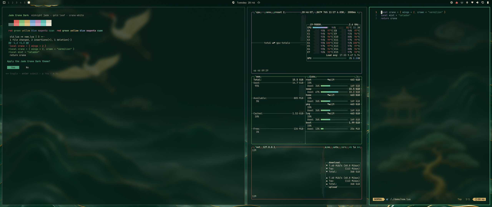

# Omarchy Jade Crane Dark Theme

Midnight jade, gold leaf, and crane-white — a dark [Omarchy](https://omarchy.org)
theme drawn from a Guofeng night landscape of jade mountains, red-crowned
cranes, and lucky clouds. Its daytime twin is
[Jade Crane Light](https://github.com/rafalyovson/omarchy-jade-crane-light-theme).



## Install

```bash
omarchy theme install https://github.com/rafalyovson/omarchy-jade-crane-dark-theme
```

Or via **Install → Style → Theme** and paste that URL.

## Palette

| Role | Hex | Note |
| --- | --- | --- |
| Background | `#0b1d17` | midnight jade |
| Foreground | `#e4dcc4` | crane-white, 12.8:1 |
| Accent | `#5fb58a` | jade, 7.0:1 |
| Active item | `#4f9e77` / `#06140e` | gum Yes/No, menus, terminal selection |
| Soft selection | `#1f3d31` | btop rows, sidebars |
| Muted | `#5d7a6c` | placeholders, line numbers, secondary buttons |
| Red | `#e5675f` | crane crown |
| Yellow | `#d4b26a` | gold leaf |
| Orange | `#e08d4e` | |
| Brown | `#a9845c` | pine bark |

Every ANSI color, normal and bright, is at least 4.5:1 on the background (WCAG
AA for text), so syntax highlighting in Neovim and VS Code/Cursor stays readable.
Muted sits at about 3.5:1 against both the background and the foreground,
because apps use it as faint text and as a button fill. Yellow, orange and
brown are separate hues, so they read differently in `git`, `ls` and prompts.
Full palette in [`colors.toml`](colors.toml). Icons are `Yaru-sage`.

## Wallpapers

| File | Size | |
| --- | --- | --- |
| `01-jade-crane-dark.webp` | 6688×3764 | the full night landscape |
| `02-crane-flight-dark.webp` | 3800×1628 | 21:9 crop of the cranes, open sky on the right for windows |
| `omarchy.webp` | 3840×2160 | Omarchy logo in jade on midnight |

Cycle with `Super + Ctrl + W`.

Both landscapes have a 5.6-second intro in `backgrounds/intros/` that plays
when you switch to them: on `01-jade-crane-dark` the mountains rise out of the
night, and on `02-crane-flight-dark` the dark clears in the cranes' direction
of flight as they glide into place. Each ends exactly on its wallpaper. To turn
intros off, run `omarchy theme bg intro disable`.

Art notes and license details are in [CREDITS.md](CREDITS.md).

## Boot and login screen

`unlock.png` is a transparent, feathered crop of the cranes, so it blends into
the midnight background on the disk-unlock and login screens. Pick it under
**Style → Unlock**, or run:

```bash
omarchy plymouth set by theme jade-crane-dark
```

## License

MIT — see [LICENSE](LICENSE).
